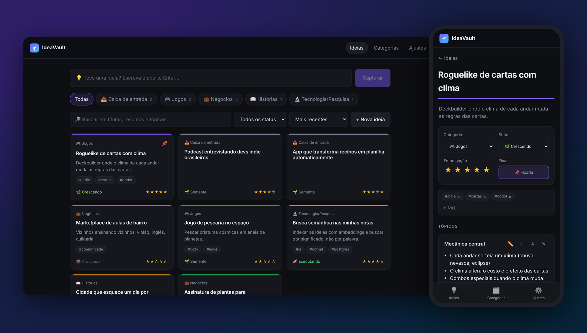
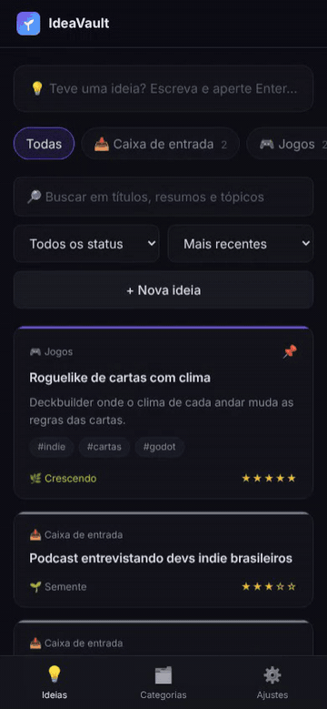
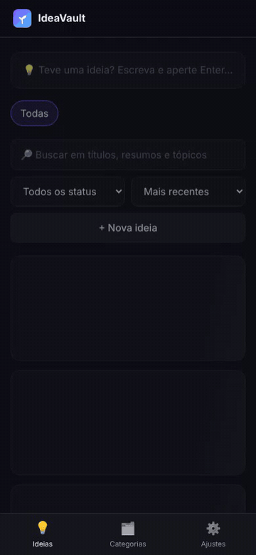
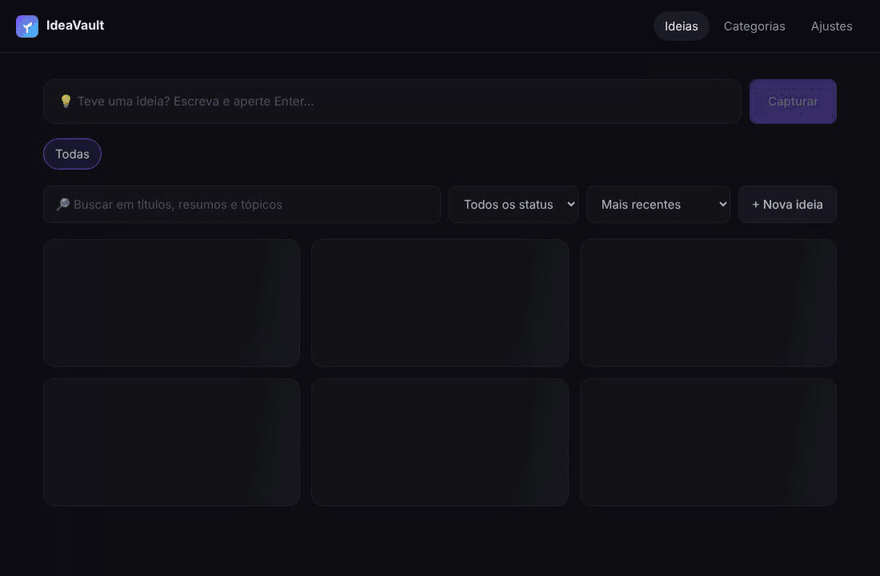
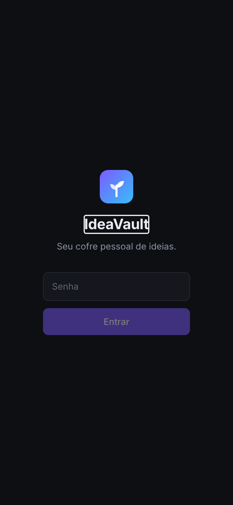
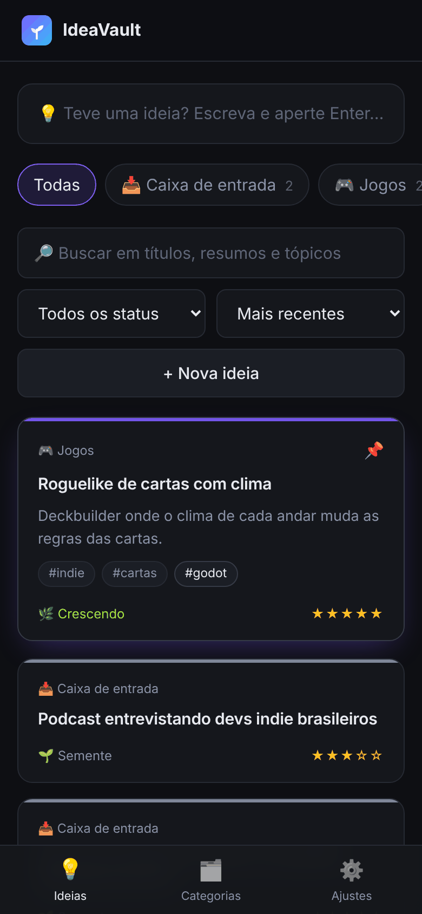
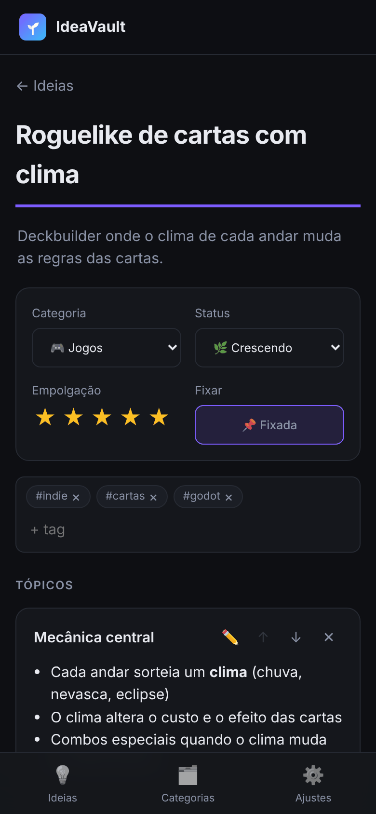
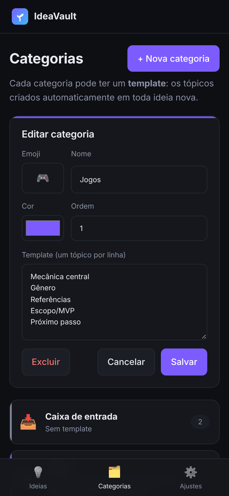
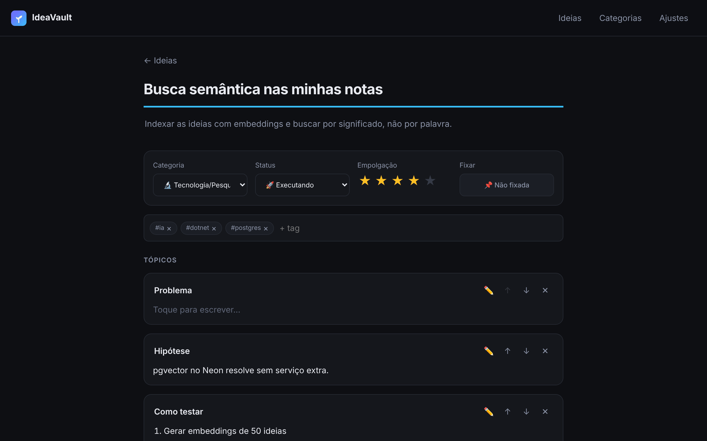
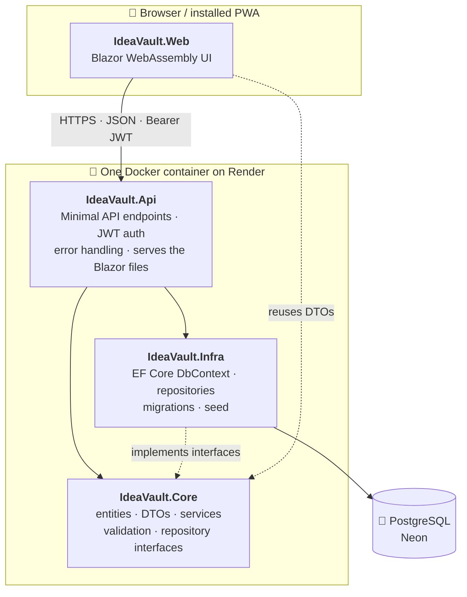

<div align="center">


# IdeaVault

**A personal vault to capture, organize and structure ideas: games, businesses, stories, research.**

[](https://github.com/Joa0DeL1ma/IdeaVault/actions/workflows/ci.yml)




</div>

IdeaVault is a single-user web app I built for myself. An idea gets captured in two seconds, from the phone or the desktop. Later it grows into a structured document: each category (🎮 games, 💼 businesses, 📖 stories…) has a **template** of topics, so a new game idea starts with *Core mechanic, Genre, References, Scope/MVP, Next step*, ready to be filled in.

It is also a portfolio project. The goal was a small, production-shaped .NET codebase: layered architecture, tests, CI, Docker, and zero hosting cost. The code is public; my ideas are not. They live in a private database, and the repository holds no data and no secrets.

> The UI is in Brazilian Portuguese (it is my personal tool); the code, docs and commits are in English.

---

## ✨ Features

| | |
|---|---|
| ⚡ **Quick capture** | Type and press Enter. The idea lands in the inbox; the first line becomes the title, the rest the summary. |
| 🧩 **Category templates** | A new idea gets the category's topics as empty sections. Templates are editable per category. |
| 📝 **Markdown topics** | Each section is markdown: rendered when reading, plain text when editing. Sections can be reordered, added and removed. |
| 💾 **Auto-save** | Edits are saved 800 ms after you stop typing, with a "Saving… / Saved ✓" indicator. Pending edits are flushed when you leave the page. |
| 🔎 **Search & filters** | Free-text search across titles, summaries **and section content**; filter by category, status and tag; pinned ideas first; sort by last update or excitement. |
| 🌱 **Lifecycle** | Status (Seed → Growing → Executing → Archived), excitement from 1 to 5 ⭐, tags, pin. |
| 📱 **Installable PWA** | Add to the Android home screen and it opens full-screen like a native app. |
| 💾 **JSON backup** | One click exports every category, idea and section. |
| 🔒 **Single-user auth** | Password, then a JWT. Constant-time comparison, login rate limiting, and all data endpoints require a token. |

## 🎬 Demo

<table>
  <tr>
    <th>Quick capture</th>
    <th>Structuring an idea</th>
  </tr>
  <tr>
    <td></td>
    <td></td>
  </tr>
</table>

**Search (matches text inside topics), tag filter and sorting**



## 📸 Screenshots

<table>
  <tr>
    <td align="center"><br /><sub>Login</sub></td>
    <td align="center"><br /><sub>Home</sub></td>
    <td align="center"><br /><sub>Idea detail</sub></td>
    <td align="center"><br /><sub>Categories & templates</sub></td>
  </tr>
</table>



<sub>Screens show demo data.</sub>

## 🧱 Tech stack

| Layer | Tech |
|---|---|
| Backend | ASP.NET Core 10 **Minimal APIs**, JWT bearer auth, rate limiting, ProblemDetails (RFC 9457), OpenAPI + Swagger UI (dev) |
| Data | Entity Framework Core 10 + **Npgsql** (PostgreSQL `text[]` for tags and templates), code-first migrations |
| Frontend | **Blazor WebAssembly** (PWA), hand-written CSS (no UI framework), Markdig for markdown |
| Tests | xUnit, SQLite in-memory, `FakeTimeProvider` |
| Delivery | Multi-stage **Docker** image (chiseled), **GitHub Actions** CI, **Render** (free) + **Neon** serverless Postgres (free) |

## 🏗️ Architecture

A **layered monolith**: one deployable unit, with dependencies pointing inward to the domain.



| Project | Responsibility | Depends on |
|---|---|---|
| `IdeaVault.Core` | Business rules (template applied on creation, quick capture to the inbox, validation, reordering), DTOs, repository interfaces | nothing |
| `IdeaVault.Infra` | EF Core mappings, queries (filters/search/sorting), migrations, idempotent seed | Core |
| `IdeaVault.Api` | HTTP surface, auth, DI composition root, global error handling, hosting the Blazor app | Core, Infra, Web |
| `IdeaVault.Web` | Screens, typed API client, auto-save, PWA | Core (DTOs only) |
| `IdeaVault.Tests` | Service, query, auth and configuration tests | Core, Infra, Api |

<details>
<summary><b>Folder structure</b></summary>

```
src/
  IdeaVault.Api/          Program.cs, Endpoints/, Auth/, ErrorHandling/, Extensions/
  IdeaVault.Core/         Entities/, Dtos/, Services/, Interfaces/, Validation/, Mapping/, Exceptions/
  IdeaVault.Infra/        Data/ (DbContext, Configurations/, Migrations/, seed), Repositories/
  IdeaVault.Web/          Pages/, Components/, Layout/, Services/, wwwroot/ (css, PWA manifest, service worker)
tests/
  IdeaVault.Tests/        one test class per service + query, auth and config tests
Dockerfile · docker-compose.yml · render.yaml · .github/workflows/ci.yml
```
</details>

### API

All `/api/*` routes except login require `Authorization: Bearer <jwt>`. Errors are `application/problem+json`.

| Method & route | Description |
|---|---|
| `POST /api/auth/login` | `{ "password" }` → `{ token, expiresAt }` (rate limited: 5/min) |
| `GET/POST /api/categories`, `GET/PUT/DELETE /api/categories/{id}` | Category CRUD (the inbox and categories in use cannot be deleted → `409`) |
| `GET /api/ideas?categoryId=&status=&tag=&search=&sort=Updated\|Excitement` | Filtered list, pinned first |
| `POST /api/ideas`, `GET/PUT/DELETE /api/ideas/{id}` | Idea CRUD; creation applies the category template |
| `POST /api/ideas/quick` | `{ "text" }` → new idea in the inbox |
| `GET/POST /api/ideas/{id}/sections`, `PUT/DELETE …/sections/{sectionId}` | Section CRUD |
| `PUT /api/ideas/{id}/sections/order` | `{ "sectionIds": [...] }`, which must list every section exactly once |
| `GET /api/export` | Full JSON backup (downloaded as a file) |
| `GET /health` | Liveness probe (does not touch the database) |

## 🤔 Technical decisions

**Why Blazor WebAssembly?** The whole stack stays in C#. The frontend reuses the backend's DTOs from `IdeaVault.Core`, so the API contract is checked by the compiler. The WASM bundle is static files served by the API itself: a single deploy, no Node toolchain, no CORS. The trade-off is a heavier first load (~ a few MB, cached afterwards by the service worker), which is fine for an app installed on my own phone.

**Why Neon + Render?** Both have free tiers that need no credit card and cover a single-user app indefinitely. Neon is serverless Postgres that suspends when idle; Render builds the `Dockerfile` straight from GitHub on every push. The cost: Render's free instance sleeps after 15 minutes without traffic, so the first request after a pause takes ~30–60 s. I accept that for a personal tool (see the roadmap for a workaround).

**Why a PWA instead of a native app?** One codebase serves desktop and mobile. There are no store fees or reviews, and updates ship with every deploy. A manifest plus a service worker give a home-screen icon and a full-screen standalone window. That is everything a native shell would add here, without Kotlin/Swift or MAUI.

**Why a layered monolith instead of microservices?** One user, one team (me), one database: microservices would add network calls, distributed failures, multiple deploys and an orchestrator, with no benefit. Layers still give the separation that matters. Business rules in `Core` know nothing about HTTP or EF Core, so they are easy to test and could be extracted later if they ever needed to be.

<details>
<summary><b>More decisions</b></summary>

- **Minimal APIs + typed results.** Less ceremony than controllers, and the endpoint files read like a route table. `TypedResults` keeps the OpenAPI document accurate.
- **Exceptions for domain failures, mapped once.** Services throw `ValidationException` / `NotFoundException` / `ConflictException`. A single `IExceptionHandler` turns them into ProblemDetails (400/404/409), so endpoints have no try/catch. Validation reports **all** invalid fields at once.
- **Repositories over EF Core.** They keep `Core` persistence-agnostic and isolate query logic (filters, case-insensitive search across sections, pinned-first ordering) in one place.
- **Tests on SQLite in-memory, with a fresh `DbContext` per operation.** Fast (≈2 s for the suite) and close to real: each "request" gets a new context over the same connection, which catches change-tracking bugs a single long-lived context would hide. A `FakeTimeProvider` makes timestamps deterministic.
- **Idempotent startup seeder instead of `HasData`.** EF Core compares seeded `List<string>` values by reference, which made `HasData` report phantom model changes. Seeding the five default categories after `Migrate()`, only on an empty database, is simpler and stable.
- **Single-user auth done carefully.** The password is compared with `CryptographicOperations.FixedTimeEquals` over SHA-256 digests, so even different lengths take the same time. Login is rate limited, and settings are validated at startup (`ValidateOnStart`), so a deploy with a missing or short `JWT_SECRET` fails fast instead of running insecurely. Unauthenticated requests never reach the database, so strangers cannot burn the free database quota.
- **Cheap to run.** The chiseled (distroless, non-root) runtime image, workstation GC and a `/health` endpoint that does not wake the database keep the app at ~130 MB RAM and let Neon stay suspended between uses.
- **Auto-save with a debouncer** instead of a Save button, plus flush-on-dispose so nothing typed is lost when navigating away.
- **Up/down buttons for reordering** instead of drag-and-drop: reliable on touch screens and no JavaScript library (drag-and-drop is on the roadmap).
- **Markdown rendered with raw HTML disabled**, so section content can never inject scripts.
- **Neon-friendly configuration.** `ConnectionStrings__Default` accepts both Npgsql key/value strings and `postgresql://` URLs, which Neon hands out by default.
</details>

## 🚀 Running locally

**Prerequisites:** [.NET 10 SDK](https://dotnet.microsoft.com/download/dotnet/10.0) and [Docker](https://www.docker.com/) (only for the local Postgres).

```bash
git clone https://github.com/Joa0DeL1ma/IdeaVault.git
cd IdeaVault

# 1. Start PostgreSQL
docker compose up -d

# 2. Run API + Blazor app (migrations and seed run automatically)
dotnet run --project src/IdeaVault.Api
```

Open the URL printed in the terminal and log in with the development password **`dev-password`**. Swagger UI is available at `/swagger` in development.

Development settings live in `src/IdeaVault.Api/appsettings.Development.json`, which is excluded from the production image. Every other environment is configured only through environment variables (see [`.env.example`](.env.example)):

| Variable | Description |
|---|---|
| `ConnectionStrings__Default` | PostgreSQL connection (key/value or `postgresql://` URL) |
| `APP_PASSWORD` | The login password (min. 8 chars) |
| `JWT_SECRET` | Token signing key (min. 32 chars), e.g. `openssl rand -base64 48` |
| `PORT` | Optional: port to listen on (set automatically by Render) |

<details>
<summary><b>New migration</b></summary>

```bash
dotnet tool restore
dotnet ef migrations add <Name> --project src/IdeaVault.Infra --output-dir Data/Migrations
```
</details>

## 🧪 Tests

```bash
dotnet test
```

53 tests cover the rules that matter:
- applying the template on creation;
- quick capture landing in the inbox (with title/summary splitting);
- every filter, the search inside section content, pinned-first ordering and both sort modes;
- excitement validation (1–5) and the other field validation;
- section add/update/delete/reorder (including invalid permutations);
- category protection rules and the export;
- constant-time password verification;
- Neon URL parsing.

CI (GitHub Actions) runs build + tests on every push and also builds the production Docker image.

## ☁️ Deploy (free)

1. **Neon:** create a project in **AWS US East 1 (N. Virginia)** and copy the connection string.
2. **Render:** *New → Web Service → Build from a Git repository*, pick this repo, runtime **Docker**, region **Virginia** (same as the database), instance type **Free**, health check path `/health`. Alternatively, *New → Blueprint* uses [`render.yaml`](render.yaml).
3. Set the environment variables: `ConnectionStrings__Default` (from Neon), `APP_PASSWORD`, `JWT_SECRET`.
4. Deploy. Migrations and the seed run on startup. Every push to `main` redeploys.

To install on Android, open the Render URL in Chrome, then choose **⋮ → Install app** (or *Add to Home screen*).

## 🗺️ Roadmap

- [ ] 🤖 AI assistant to suggest a structure for an idea or expand a section
- [ ] 📴 Offline mode with background sync (queue edits in IndexedDB)
- [ ] 🔗 Links between ideas (backlinks, "related ideas")
- [ ] 🖼️ Image attachments (object storage)
- [ ] ↕️ Drag-and-drop reordering of sections
- [ ] ♻️ Import from a JSON backup
- [ ] 🔍 Ranked full-text search (`tsvector`) and typo tolerance (`pg_trgm`)
- [ ] 🧪 Playwright end-to-end tests in CI and API integration tests with Testcontainers
- [ ] ⏰ Optional keep-alive ping to avoid Render cold starts
- [ ] 🌗 Light theme

## 📄 License

[MIT](LICENSE)
